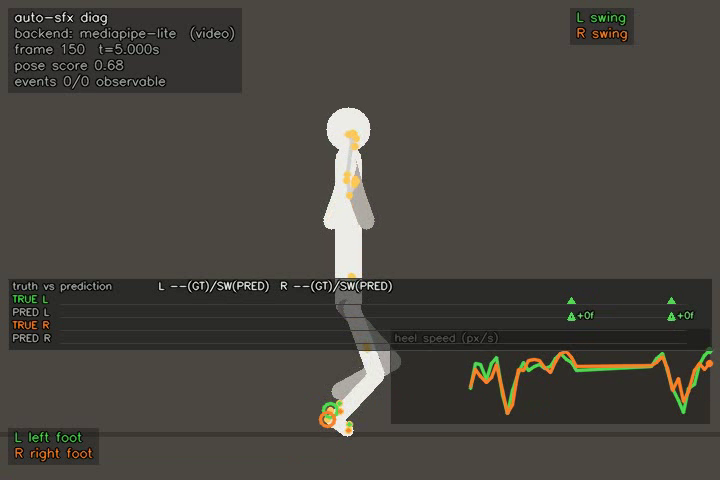
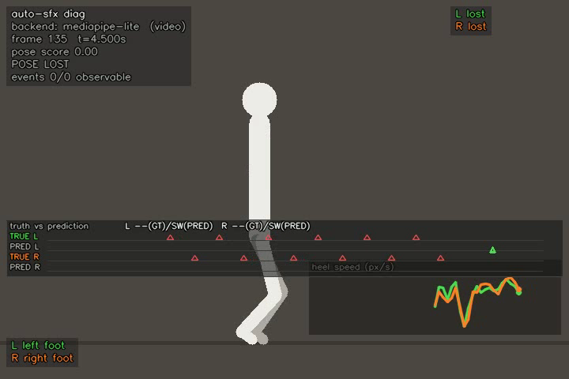
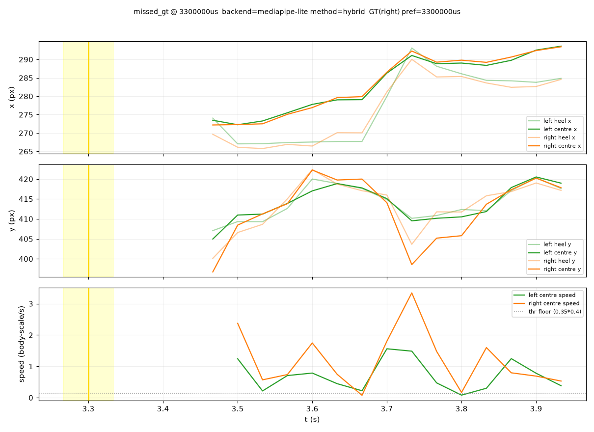

# Auto-SFX Phase 2 — CTO Update #1 (tooling + forensic audit, pre-ground-truth)

**Date:** 2026-08-25 · **Repo:** `Coriou/py-audio-box`, local commit `cafa067` — nothing pushed (directive §0 honored)
**Directive:** `docs/auto-sfx-phase2-truth-repair.md` · **Predecessor:** `CTO-REPORT-auto-sfx-poc.md` (Phase 1 + your review)
**Status:** Checkpoint A tooling complete · ground-truth marks requested from operator · **no algorithm changes made**

---

## 1. TL;DR

Phase 2's gate was "ground truth + forensic diagnosis **before** any algorithm change." The measurement
instrumentation for that gate is now fully built, tested (196 green in-container), and smoke-verified
end-to-end; the state machine itself has been audited line-by-line and the audit produced a concrete,
**falsifiable mechanism-level diagnosis** of the wrong-phase problem you flagged in the Phase-1 erratum.
The single blocker is human: ~20 s of hand marks on each criticized clip. Everything downstream
(classification, signed timing distribution, error tables, Checkpoint A report) fires automatically on
those marks — pose caches make the detector re-runs free.

**The one-sentence finding of the audit:** the detector stamps an `initialContact` at the *first frame a
moving foot looks slow* — a state feature — and a planted foot looks slow for the whole stance, so the
event time is systematically *early* by the swing deceleration tail (est. 2–6 frames @30 fps) and, via a
second mechanism, can fire entirely after toe-off. This predicts your A1 anomaly classes and is directly
testable against the marks.

---

## 2. Status vs the directive's execution order (§6)

| Step | State |
|---|---|
| 1. Verify baseline (pytest + selftest) | **Done** — 196 tests green in-container; selftest plumbing-regression pass. Also fixed `make auto-sfx-test` (was broken: `tests/` is dockerignored, target never mounted it). |
| 2. T15 preview v2 + T1 GT loader | **Done** — see §3/§4.1, smoke-verified on real rendered video. |
| 3. T4 semantic audit (parallel) | **Done** — `reports/T4-contacts-audit.md`, headline in §5. |
| 4. T1 ground truth walk1+walk2 | **Blocked on operator** — §9 ASK issued with suggested ranges. |
| 5. T2 forensics + T3 classification + T14 metrics v2 → Checkpoint A report | T2 + T14 **tooling done** (built early; acceptance needs GT). T3 fires on marks. |
| 6–7. B-track repairs, Checkpoint B/C | Not started — gated on your review of Checkpoint A, per directive. |

---

## 3. What was built (all inside `experiments/auto-sfx/`)

| Piece | File(s) | Notes |
|---|---|---|
| GT v2 loader/validator | `src/auto_sfx/gt.py` | §5.1 contract enforced: foot/visibility/viewpoint vocabularies, integer PTS typing, `earliest ≤ preferred ≤ latest`, sort order; out-of-range & simultaneous-mark **warnings** (non-fatal, operator-friendly). Legacy v1 arrays still readable by `metrics`. 23 tests. |
| `analyze --gt` wiring | `src/auto_sfx/cli.py` | Invalid GT fails fast (exit 2) before any expensive stage; GT provenance recorded in `events.json`. |
| **T15 diagnostic preview v2** | `render.py`, `markers.py` | `annotated.mp4` gains a GT-vs-prediction timeline strip (TRUE/PRED × L/R rows over a 6 s window; filled ▲ = GT matched by a prediction, hollow red ▲ = GT no prediction came near; signed `+Nf` frame-error labels, colour-coded ≤±1 / ≤±3 / worse; phase chips `L STANCE(GT)/SW(PRED)`). `marker-preview` audio gains a **second, distinct GT voice** (620 Hz, 130 ms, centred) vs the hard-panned prediction clicks — phase error is audible, not just visible. v1 behaviour bit-identical when no GT supplied. 13 tests. |
| **T14 metrics v2** | `metrics.py`, `metrics` CLI | §5.4 shape: existence (v1 fields nested + P/R) · side (side-agnostic matched, attribution accuracy, flip pairs) · timing (signed errors, bias, median/p90/p95 \|err\|, ±1/±2-frame fractions, >3-frame catastrophic count) · phase (midpoint-segment map into `early_swing / IC_neighborhood / mid_stance / terminal_stance / toe_off_neighborhood`, approximation documented *in the report itself*) · sequence (same-side-consecutive, simultaneous-IC, cadence outliers). v1 GT in → v1 report out (back-compat). |
| **T2 forensics** | `src/auto_sfx/forensics.py`, `run forensics <run-dir> [gt.json]` | Per-event §5.2 JSON windows + PNG (x/t, y/t with GT shading + preferred line + predicted marker; speed + threshold) + multi-cycle summary PNG — computed **from cached `pose.jsonl` only**, no re-inference. Emits for every predicted event *and* every missed GT contact. Honesty notes baked into every window: no smoothing applied here (`conf_smoothed` mirrors raw), state derived from event windows (machine internals aren't persisted — see Q3), `transitions: []`. Verified: 28 windows on the smoke run. 5 tests. |
| Summarizer v2 columns | `scripts/summarize_runs.py` | Appends `P / R / bias / med\|e\| / cat>3f` when a run has v2 `metrics.json`. ⚠️ `summarize_analyze`'s body was accidentally destroyed during editing and **reconstructed** from the CTO report's documented output format; verified against known values (real-walk1: 25 events, 11/14, 0.57/2.13 s, 42 % in-band — exact match to Phase-1 report §4.2). |

---

## 4. The interesting outputs (from the synthetic smoke run — plumbing only, not evidence of real-contact timing)

### 4.1 Truth strip — the debugging loop you asked for (`phase2-assets/truth-strip-*.png`)



Frame from `smoke-gt-aligned/annotated.mp4`: GT marks were placed **at** two predicted events, so both
`TRUE L` triangles are filled (matched) and the `PRED L` row shows green `+0f` labels — zero signed frame
error, visible at a glance. Chips read `L --(GT)/SW(PRED)` (before first mark: unknown, never invented).



Frame from `smoke-gt-t15/annotated.mp4`: predictions land 19+ frames from every mark (beyond the ±0.5 s
pairing horizon), so all GT triangles render **hollow red** and predictions get no label — the strip
visually screams "detector is at the wrong phase here," which is exactly the Phase-1 failure mode, now
made inspectable per-frame.

### 4.2 Forensic window for a missed GT contact (`phase2-assets/forensics-missed-gt.png`)



One `missed_gt` window (GT right-foot contact @3.30 s, no prediction within ±0.5 s): heel/centre
trajectories in x and y, GT interval shaded, and foot-centre speed against the detector's threshold
floor. The gap before 3.47 s is honest `POSE_LOST` absence, not a plotting bug. With real marks, this is
the per-error artifact the audit's hypotheses will be confirmed/killed against.

### 4.3 Metrics v2 in action

`run metrics <run-dir> gt.json` now prints, per run: `precision / recall / bias_s / med|e| / cat>3f /
impossible_simultaneous_ic …` (v2 GT) or the familiar v1 table (v1 GT). Sample on the smoke run: `P=0.0
R=0.0, impossible_simultaneous_ic=2, same_side_consecutive=5` — the sequence faults you flagged in A1 are
now first-class measured quantities.

---

## 5. T4 audit — mechanism-level findings (`reports/T4-contacts-audit.md`)

Line-referenced audit of every transition of `UNKNOWN→SWING→CANDIDATE→STANCE→EXIT`. Ranked hypotheses
for the observed anomalies, each with its code chain and a falsifiable prediction:

| # | Mechanism | Code | Predicts | Falsified/confirmed by |
|---|---|---|---|---|
| 1 | **Stamp policy on a state feature.** Event time = first frame below `0.35 × swing_peak` (start of a possibly-long low region). Swing *decelerates before touchdown* → stamp precedes IC; toe-whip keeps the landmark-mean speed high after touchdown → stamp trails IC. | L574-582, L707-713, **L616**, L1029-1031 | systematic signed timing errors in **both** directions, spread O(2–6 frames); `±1 frame` uncertainty window is understated | signed error distribution per GT (T3/T14) |
| 2 | **EXIT-relaxed confirmation.** After any confirmed stance, a 2-frame speed dip re-opens a candidate that skips the duration *and* ascent guards. | L721-728, L625 | events in terminal stance / right after toe-off → `LATE_STANCE`, `TOE_OFF_CONFUSED_AS_CONTACT`, duplicates | forensics windows on relaxed-run events; cheap detector-side logging later |
| 3 | **Pelvis/Zeni phase fragility (A2).** Sway-null window length comes from the *first* ACF local maximum — noise locks it off-band and step-rate sway peaks masquerade as strikes; plus 2D-monocular "max anterior offset" is not demonstrated to coincide with IC for these camera geometries. | L757-783, L837-852, L144 | pelvis events at a *different gait phase* than velocity — the observed 0–14 % agreement | T12 with GT: label which physical phase pelvis actually fires on |

Also documented: nothing enforces L/R alternation or forbids simultaneous L+R (they survive by
construction; only diagnostics flag them), side identity is inherited from the backend with no anatomical
check (A3), and no toe-off event is ever emitted despite the marker audio supporting one.

**Per the directive, no thresholds were patched.** The audit only locates; the marks decide.

---

## 6. Verification & integrity

- `make auto-sfx-test` → **196 passed** in-container (155 baseline + 41 new: 23 GT loader, 13 T15, 5 forensics). Selftest: plumbing-regression pass only, kept out of headline claims per §0.
- T15 verified against real rendered frames (not just unit assertions): WAV energy present at every GT preferred instant and silent before; strip states (filled/hollow/labels) confirmed by frame inspection.
- Forensics verified in-container on the smoke run (28 windows + summary + index).
- Local commit `cafa067`; working tree clean except this update.

---

## 7. Blocked on operator — the ASK (issued verbatim per §9)

```
ASK (ground-truth marks)
Clips & ranges: work/auto-sfx/clips/walk1.mp4  10.0–30.0 s
                work/auto-sfx/clips/walk2.webm 18.0–28.0 s
For every visible initial contact, give: foot (left/right/uncertain),
earliest / preferred / latest frame (use: experiments/auto-sfx/run annotate
<clip> --at <t> --frames 7  → prints frame/PTS, saves PNGs to scrub),
visibility (clear/partial/occluded), viewpoint if known.
Format: fill experiments/auto-sfx/gt/<clip>.gt.json (schema §5.1; worked
example at work/auto-sfx/gt/walk_synthetic.smoke.gt.json). Partial marks
welcome; uncertain foot is a valid value.
```

Ranges were chosen from existing run artifacts: walk1 is clean end-to-end; walk2's 18–28 s is the largest
span between pose-lost close-up clusters (15.9–17.5 s, 29.6–34.9 s per `real-walk2` diagnostics).

---

## 8. Questions where CTO advice would change what we do next

1. **GT protocol sufficiency.** Two clips / ~10–20 s each is the directive default. Given the audit says
   the key measurand is the *signed* error distribution (needs enough marks per view class), do you want a
   third short clip (e.g. `man-walk-no-audio.mp4`, 9 s) marked now to get a frontal/diagonal data point,
   or keep Checkpoint A minimal and extend only if the distribution is inconclusive?
2. **First B-track repair.** The audit points at the *stamp policy + state-vs-transition confusion*
   (mechanisms 1–2) as the dominant pair, which matches your priority order (correct phase before side
   before duplicates). Do you agree the first repair candidate is T5-style per-frame contact-state
   estimation with the event defined as the *rising transition into sustained grounded* — rather than
   threshold retuning inside the current machine?
3. **Instrumentation carve-out.** Forensics currently approximates machine state from event windows
   because `contacts.py` doesn't persist per-frame states/transitions. Persisting them is a small,
   behaviour-neutral change but touches the detector; strictly interpreted, the Checkpoint-A gate forbids
   algorithm changes. May we treat state-persistence as allowed instrumentation before the marks land?
4. **Carried-over defect (A7).** `walk2.mp4` remains unfinalized (missing moov); we standardise on
   `walk2.webm`. Fix the upstream splitter now or after Checkpoint B?

---

## 9. Appendix — reproduce

```bash
make auto-sfx-test                                   # 196 passed
./experiments/auto-sfx/run selftest                  # plumbing regression, raw values
# GT-attached analyze (truth strip + GT voice):
./experiments/auto-sfx/run analyze /work/auto-sfx/fixtures/walk_synthetic.mp4 \
    --gt /work/auto-sfx/gt/walk_synthetic.smoke.gt.json --run-id smoke-gt-t15
# Per-event forensic windows from the cached trace:
./experiments/auto-sfx/run forensics /work/auto-sfx/runs/smoke-gt-t15 \
    /work/auto-sfx/gt/walk_synthetic.smoke.gt.json
# v2 metrics:
./experiments/auto-sfx/run metrics /work/auto-sfx/runs/smoke-gt-t15 \
    /work/auto-sfx/gt/walk_synthetic.smoke.gt.json
```

Key artifacts: `reports/T4-contacts-audit.md` (audit) · `reports/CHECKPOINT-A-progress.md` (state) ·
`work/auto-sfx/runs/smoke-gt-t15/` (GT-attached run: events/metrics/forensics) ·
`work/auto-sfx/runs/smoke-gt-aligned/` (aligned-GT strip demo) · `reports/phase2-assets/` (this update's images).
